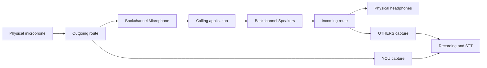

# Virtual audio devices experiment

Date: 2026-10-28
Status: Draft for product review; no implementation or platform readiness implied.
Companion: [Implementation plan](virtual-audio-experiment-plan.md).

## Goal and hypothesis

Let a person select Backchannel as the microphone and speaker in a calling application,
select physical devices inside Backchannel, and record both directions through those
virtual endpoints. Test whether this is a useful, dependable alternative to passive capture.

The hypothesis is that an explicit audio route makes setup and recording boundaries easier
to understand without adding unacceptable latency, failures, or device-management work.
The experiment includes **both** virtual endpoints. An output-only spike is an intermediate
engineering checkpoint, not completion of the requested experience.

Success means a supported calling application can use both endpoints, a real conversation
continues while Backchannel records and transcribes it, and the failure and latency criteria
below hold. Failure of these criteria is a valid experimental result.

The usefulness half of the hypothesis is tested first and cheaply, with existing third-party
loopback devices and no Backchannel driver (plan step 1). The dependability half needs the
owned driver and is tested after that check returns go.

## Scope and platform boundary

Product-owner decisions of 2026-10-28, recorded in
[ADR 0033](decisions/0033-the-virtual-audio-experiment-is-built-on-macos.md):

- Development and runtime verification of this experiment happen on **macOS**. This
  overrides, for this experiment only, decision 5 of ADR 0005 ("the development environment
  is this Linux machine only") and the matching line of `.claude/rules/platform-code.md`. It
  does not change the project's support tiers.
- **No Apple Developer Program membership.** Nothing is notarized or signed with a Developer
  ID. Every component is built and installed locally on the development Mac, signed ad hoc or
  with a local self-signed certificate. The experiment therefore cannot be handed to anyone
  else, and its results say nothing about notarization, Gatekeeper or distribution.
- **No feature flag.** The experiment lives on one experiment branch in a separate Git
  worktree. If the experiment decision is continue, that branch is merged into `main` through
  its own pull request and gate; otherwise it is not merged. This is a declared exception to
  "`main` is the only long-lived branch" and is bounded by the experiment decision.

Further boundaries:

- Linux and Windows implementation and runtime verification are deferred. Linux verification
  is currently difficult to arrange and is not a prerequisite for evaluating the macOS
  experiment. macOS results establish nothing about either deferred platform.
- Record the worktree path and branch in the umbrella issue before coding. Keep experimental
  implementation out of the primary checkout.
- A worktree isolates repository changes, not installed audio components or OS state: the
  HAL plug-in, the routing helper's launchd job, TCC grants and Core Audio state are
  machine-wide. Track what is installed and provide explicit cleanup on the development Mac.
- Existing passive recording remains selectable. A proxy recording must not silently fall
  back to passive global capture or a different microphone.
- No automatic call detection, automatic recording, meeting-platform API integration,
  new acoustic echo cancellation, outgoing voice effects, or per-participant separation.
- Headphones are the reference configuration. Speakerphone and Bluetooth are measured
  separately and cannot inherit the wired-headphone result (ADR 0004).
- The split transcript is limited to segmented (VAD + batch) models. Streaming models are
  fed a summed signal today (`transcription/adapters/summed.rs`) and are not offered in
  proxy mode; isolated streaming sessions are out of scope.
- No release or distribution to users follows from approval of this specification.

## Devices and routes

Expose two public endpoints with stable backend identities:

| Public name | Role in calling applications | Physical target configured in Backchannel |
| --- | --- | --- |
| Backchannel Microphone | Selectable microphone / capture endpoint | Real microphone supplying the outgoing route |
| Backchannel Speakers | Selectable speaker / playback endpoint | Real headphones or other playback device |

Names are proposed display names, not identity keys. Private bridge ports must not appear
as additional confusing choices in normal application pickers.

YOU is copied from the signal supplied to the virtual microphone after Backchannel's
own mute. OTHERS is copied from audio received by the virtual playback endpoint before
physical output volume. Preserve incoming stereo for playback; STT may downmix a copy.
Never route OTHERS into the virtual microphone. Local microphone monitoring is off.
Never combine the two directions before the split-channel transcription boundary.

Only streams explicitly sent to Backchannel Speakers are in OTHERS. This is endpoint
isolation, not proof of meeting isolation: another application can also select the endpoint,
and one browser can send several tabs to it. Do not combine proxy capture with a global
system tap, which would duplicate incoming audio and collect unrelated sound: while proxy
mode is enabled, the Core Audio process tap in `capture/core_audio.rs` is not started.

### The physical microphone opens on demand

The routing service opens the physical microphone only while a client is running I/O on
Backchannel Microphone, and closes it when the last client stops. The HAL plug-in observes
this directly (`StartIO` / `StopIO`). Holding the microphone open whenever routing is
enabled would:

- keep the macOS microphone indicator lit and attributed to Backchannel with no call;
- switch a Bluetooth headset into its hands-free profile, degrading all its playback;
- spend power for no recording.

Until the physical microphone delivers, Backchannel Microphone supplies silence. The time
from a client's start to the first physical sample is measured (A14). The physical output
follows the same rule for Backchannel Speakers.

## Platform architecture on macOS

Proposed, to be confirmed by the feasibility spike (plan step 3) and recorded in an ADR.

- **HAL plug-in** (AudioServer plug-in, `/Library/Audio/Plug-Ins/HAL/`), built as a universal
  binary (only arm64 can be run on the development Mac; x86_64 is unverified), loaded by `coreaudiod` in its sandbox. It publishes the two public devices and their
  private bridge side, owns their clock (`GetZeroTimeStamp`), and reports client I/O state.
  It holds no routing logic. If the helper is absent, Backchannel Microphone supplies
  silence and Backchannel Speakers discards; the devices do not disappear.
- **Routing helper**, a user-space process separate from the Tauri application, started as a
  per-user launchd agent. It opens the physical devices, moves audio across the bridge with
  rate conversion in both directions, applies mute, and serves state and control to the
  application over a local per-user channel. Bridge transport (Mach service declared in the
  plug-in's `AudioServerPlugIn_MachServices`, or hidden devices) is chosen by the spike.
- **Microphone permission belongs to the helper**: TCC grants it to the helper's code
  identity, not to the application. Ad-hoc signatures change with every build, which turns
  each rebuild into a new identity and a new prompt; a local self-signed code-signing
  certificate gives a stable designated requirement without an Apple account. The spike
  confirms which one TCC accepts for a launchd agent.
- **Installation needs administrator rights and restarts `coreaudiod`**, which interrupts all
  audio on the machine, including a call in progress. Without a Developer ID there is no
  privileged installer: the setup screen detects the plug-in and shows the exact install,
  upgrade and removal commands with their consequences. It never runs them silently and
  never restarts `coreaudiod` while an endpoint is in use.
- **Whether `coreaudiod` loads an ad-hoc or self-signed plug-in** on the development Mac's
  macOS version is the spike's first observation. If it does not, the experiment stops at
  the spike or is revised; it does not acquire a Developer ID without a product decision.
- **Shared state.** Preferences and state that both the helper and the application read live
  under the application's identifier `tech.madduck.backchannel` (ADR 0029), with one owner
  for writes: the helper.

Linux and Windows lifecycle notes, deferred with those platforms: on Linux the endpoints
would be session nodes recreated after login when the routing service starts, which is not
equivalent to an installed driver; on Windows a signed driver and possibly a reboot are
required. The platform adapter reports which lifecycle actually applies.

## First run and installation lifecycle

1. First run offers the experiment and explains the two endpoints and routing dependency.
   The person can enable it or continue with passive capture. An experimental build may
   make this setup the initial screen; enabling routing still does not start recording.
2. Detect backend availability, plug-in presence and version, helper state, permissions and
   existing owned endpoints. Repeated setup and app launches reconcile state rather than
   creating duplicates.
3. If the plug-in is missing or outdated, show the administrator step, state that it
   restarts `coreaudiod` and interrupts all audio, and detect completion. Never describe it
   as silent first-run registration.
4. Install or start the routing helper as a per-user launchd agent and request the
   microphone permission for it. A declined permission is a retryable state.
5. Select a real microphone and real output. Exclude Backchannel endpoints and known
   self-referential routes. Test microphone delivery and physical playback separately.
6. Show the exact names to select in the calling application. Do not change OS defaults,
   communication defaults, or another application's settings automatically. Changing the
   defaults would send unrelated applications through the recording endpoint.
7. Show routing readiness and recording state separately. If either route fails verification,
   setup is incomplete; provide retry, device selection, and passive-mode exit.

Declined permissions, interrupted installation and partial installation are retryable states.
Upgrades preserve endpoint identity and selections. Plug-in and helper upgrades or removal
are deferred during active use. Explicit disable/removal closes owned routes and removes
only components owned by this installation, never third-party virtual devices or recordings.
The installed plug-in keeps both devices visible when the application and helper are not
running; they then carry silence.

## Daily use and controls

Settings configure microphone, physical output, routing enablement, startup preference,
route tests, and installation/repair status. The tray provides microphone and output
selection, outgoing microphone mute, recording start/pause/stop, status, and open settings.
The tray and settings operate on one authoritative routing service state.
On desktops without a usable tray, settings provide all operations.

Changing a physical device keeps public endpoint identities unchanged. Prepare and validate
the replacement, then commit the change; on failure retain the previous working route and
selection. If the previous device disappeared, expose the route as unavailable. Never
silently choose a new microphone or redirect playback to laptop speakers. Offer an explicit
replacement. Known derived/aggregate/monitor routes require cycle checks, not just name filters.

Minimizing or closing the main window leaves enabled routing running with its helper.
Explicit Quit distinguishes closing the UI from stopping routing. Warn when clients use the
endpoints and offer to keep routing running. Stop-routing remains an explicit action.
When client-use detection is unavailable, say so and show the warning conservatively.

## Routing, recording, mute and completeness

Routing works with recording stopped, paused, or running; without an STT model; and when
STT fails. Starting/stopping a recording never creates or tears down the live call route.
Pause excludes new audio from persistent recording and STT; resuming starts with new audio,
without replaying the pause interval. Playback and outgoing speech continue while paused.

An explicit Backchannel microphone mute clears Backchannel-owned pending outgoing frames
and supplies silence to the virtual microphone and YOU capture from the next service audio
buffer after mute is applied. It cannot revoke samples already handed to the OS, calling
application or network. Record the applied monotonic timestamp; show requested versus
applied state in both controls. It is separate from recording pause. Hardware mute retains
hardware semantics. Proposed control-request-to-applied p95 is at most 100 ms; measure
applied-to-endpoint silence separately from residual downstream buffered audio.

A calling application's Mute is downstream of the virtual microphone. Backchannel cannot
infer it from an open device or audio levels. While that app is muted, YOU may still be
recorded. Explain this during setup and beside recording controls. The experiment does not
claim to record exactly what remote participants heard after application DSP or network loss.

Both route captures are required for a proxy meeting. Reject recording start if either is
unavailable. A missing client is not an error: a configured but unused route may be silent.
During recording, distinguish genuine silence from stream loss using stream/clock health,
not RMS alone. Stream loss, queue overflow, writer failure or permission loss makes the
recording visibly incomplete with timestamped gap metadata; never report complete capture.
Keep the unaffected route and live call running where possible.

## Proposed architecture and data contracts

Use a routing service separate from the UI/STT lifecycle (on macOS, the helper above).
Separation is a design requirement to test, not a promise of crash survival. Do not use the
existing recording manager as the owner of live call forwarding.

- Platform adapter: capability probe, endpoint lifecycle, route creation/reconfiguration,
  stable identities, client-use observations, clock/health telemetry and cleanup.
- Routing service: desired versus applied selections, serialized transitions, microphone
  mute, on-demand device opening, monitoring and authenticated local control; no network
  listener.
- Capture adapter: attaches only during recording, emits YOU/OTHERS with a shared monotonic
  timeline into the existing transcription ports and recording infrastructure.
- UI/tray client: observes actual state and requests operations; a successful request alone
  does not mark installation, device switching or signal delivery complete.

Store versioned new preferences: enabled flag, plug-in/helper version, stable
microphone/output identities and startup preference. Do not rename existing storage keys.
A missing identity remains unresolved; a matching display name alone is insufficient.

Audio forwarding callbacks must not wait for STT, disk, IPC responses or UI. Use bounded
capture handoff and explicit overflow reporting. Slow STT must neither stall the call nor
silently trim history (ADR 0027): retain durable audio for later recovery while storage is
healthy; if durable capture fails, surface incompleteness and stop claiming a full record.
Recording-disabled operation retains no conversation history for later replay.

Persist independently addressable YOU and OTHERS audio with shared timing for experiment
verification and recovery; preserve the existing mixed playback artifact where needed.
Define ownership, disk-full behavior, cleanup and mixed-file compatibility before adding
new artifacts. Raw track persistence follows recording state, including pause.
In proxy mode the model picker offers segmented models only and says why.

Backend negotiation handles formats, resampling and independent device clocks. The virtual
devices run in their own clock domain, so rate conversion between them and each physical
device is required in both directions; A5 measures it. Start with 48 kHz PCM at the bridge
boundary; negotiate hardware formats rather than requiring 48 kHz devices. A client that
changes the virtual device's nominal sample rate during a call is either followed or refused
explicitly, never silently mis-clocked. Drift, underruns and discontinuities are measured
and reported. Output volume changes must not remove incoming speech from the recording tap.

A calling application cancels echo against what it sent to Backchannel Speakers, while the
sound reaches the room later by the bridge's latency. With headphones this does not matter.
On speakers, A4's added latency shifts the remote side's echo path; this is one reason the
speaker result is measured separately.

## Proposed experimental acceptance criteria

These are targets, not measured results. The thresholds are inlined in #273; metrics, sample
counts, matching rules and the rig are frozen there at the end of plan step 2, before the spike.
Changing them later requires an explicit scope decision.

| ID | Observation that settles the requirement |
| --- | --- |
| A1 | Fresh supported session exposes exactly the two owned public endpoint roles; repeat launch/repair produces no duplicates and does not change OS defaults. |
| A2 | A real calling application enumerates and uses both endpoints; a second physical or independently isolated peer sends and receives distinct speech markers. |
| A3 | A healthy 60-minute wired-headphone baseline includes silence, alternation and simultaneous speech. **Bridge oracle:** independent references at the endpoint boundary (a local test client on both virtual endpoints, and the physical devices) find zero missing or duplicated expected marker blocks in both recorded tracks and in both forwarded directions. Any unexpected gap fails this baseline even when reported. **Peer oracle:** delivery to a network peer is reported with its loss rate, not held to zero, because codec concealment and packet loss are outside the bridge. Exclude explicitly scheduled pause/mute intervals from the corresponding oracle, and count outgoing markers from A14's first physical sample, not from the client's start. Switching and fault-injection runs are separate. |
| A4 | Incremental local routing latency against a direct-device baseline has p95 at most 30 ms per direction; end-to-end peer latency is reported separately, not attributed entirely to the bridge. |
| A5 | Recorded markers in YOU/OTHERS have p95 alignment error at most 50 ms after one hour, measured against a shared reference; no cumulative unreported drift. |
| A6 | An unrelated app sent to a different output is absent from OTHERS while a call marker is present in the same run. Routing that app to Backchannel Speakers makes it present (positive control). |
| A7 | Physical-device switching succeeds with the same public identities and at most 1 s interruption; failed switching retains the old route where still available. Unplugging never silently selects another mic or speakers. A client changing the virtual device's sample rate is followed or refused visibly. |
| A8 | UI termination and STT crash/load do not interrupt forwarding; deliberately killing the routing helper leaves both public devices present and silent, and produces a measured, visible failure/recovery result. No automatic bypass is promised. |
| A9 | Start/stop/pause recording preserves forwarding; paused/stopped intervals appear in neither audio artifacts nor resumed STT. Backchannel mute meets the 100 ms p95 request-to-applied target and emits zeros from the next owned buffer, using applied sample timestamps; independently, the first all-zero buffer read by a test client on Backchannel Microphone follows the request by at most 150 ms p95, so the product's own timestamp is not the only evidence. Residual client/peer buffering is measured separately. Call-app mute behavior matches the documented boundary. |
| A10 | Denied permission, suspend/resume, `coreaudiod` restart, writer failure and capture-queue exhaustion are detected, with route/recording states and gap boundaries matching independent evidence. |
| A11 | Normal disable, interrupted setup, repeated repair, upgrade and removal preserve unrelated audio state and leave no duplicate/orphaned owned devices, launchd jobs or processes. |
| A12 | A non-default microphone and non-default output work; proxy mode offers no model that would sum the split transcript. Tray/settings agree after success, error and restart. |
| A13 | With a named compatible model and fixed distinct speech fixtures, both directions produce the expected phrases with correct YOU/OTHERS labels, including overlapping speech. Scheduled stopped/paused markers are absent. Freeze phrase-matching rules before the run; PCM fidelity is still established independently by A3. Suppressing decoder output or swapping labels must fail this check. |
| A14 | With no client on Backchannel Microphone the physical microphone is closed (the OS microphone-in-use state agrees). A client starting I/O opens it, with start-to-first-physical-sample p95 at most 500 ms on a wired microphone (Bluetooth reported, not held); the last client stopping closes it. Same for the physical output and Backchannel Speakers. |

Application compatibility is a measured matrix, not a universal claim. Record exact OS,
audio server, app/browser version, device/transport, permission state and endpoint behavior.
First platform target on macOS: one native calling client and one browser calling client that
permits both selections. Where output selection is unavailable, report unsupported in-app
routing; do not quietly change system defaults to pass. Bluetooth and speakers get separate
results.

## Failure boundary and experimental decision

A UI or AI failure should be contained by the routing architecture. A routing helper,
plug-in or `coreaudiod` failure can still stop the call. The recovery test must record what
each participant actually hears, endpoint continuity and time to recovery. An error message
alone is not evidence of restored audio. Offer instructions to select physical devices
directly.

Two decision points:

- **After the loopback check (plan step 1):** go if the maintainer finds the explicit-route
  setup useful with borrowed devices; stop otherwise, before any driver work.
- **After qualification:** continue — merge the experiment branch into `main` — only if
  macOS meets A1–A14 and the maintainer finds setup and switching useful. Revise if benefits
  hold but measured reliability/latency fails. Stop or narrow the approach if compatible
  apps cannot select the devices or recovery costs exceed the value. Unverified platforms
  remain unavailable as supported experimental backends.

Merging is not a release. Distribution would additionally need a Developer ID, notarization
and a privileged installer, each a separate product decision.

## Evidence and unresolved decisions

Source inspection on 2026-10-28, not runtime verification: `audio/stream.rs` owns capture
streams; `audio/capture/core_audio.rs` creates a global tap; `audio/pipeline.rs` forwards
split STT chunks and mixed recording audio; `audio/transcription/mod.rs` sums the streaming
path; `tray.rs` already implements recording controls. All paths are under
`frontend/src-tauri/src/`. Existing code does not establish virtual-device forwarding.

Platform sources checked on 2026-10-28:

- [Apple audio-driver guidance](https://developer.apple.com/videos/play/wwdc2021/10190/)
  directs purely virtual devices to the Audio Server plug-in model. Loading without a
  Developer ID, service interaction and current OS compatibility require the spike.
- [PipeWire loopback](https://docs.pipewire.org/page_module_loopback.html) supports virtual
  sinks/sources and routing (deferred Linux backend).
- [Microsoft SysVAD](https://learn.microsoft.com/en-us/samples/microsoft/windows-driver-samples/sysvad-virtual-audio-device-driver-sample/)
  is a driver framework sample; its simulated loopback is not a ready forwarding bridge
  (deferred Windows backend).

Plug-in starting points to compare in the spike, licences to be confirmed against the
project's MIT licence before any code is reused: Apple's NullAudio sample; libASPL (a C++
library for HAL plug-ins); BlackHole (GPL-3.0, usable as an installed tool for the loopback
check, not as a source to copy into this repository without a licence decision).

Before a backend is chosen, resolve reuse versus implementation, dependency licences,
bridge transport, helper launch mechanism, TCC identity, ownership across multiple app
instances, crash recovery and runtime-test access. Document lasting choices in a new ADR;
this draft does not supersede the accepted AEC, transcription or workflow decisions.
